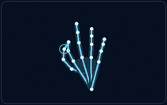
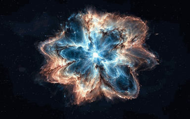
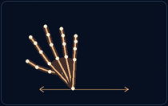
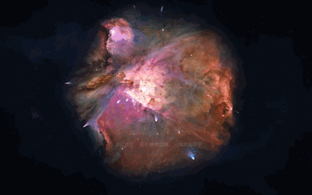
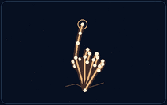
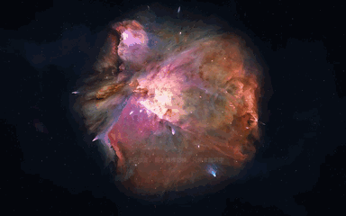

<!-- README_SYNC: source=working-tree; updated=2026-11-10 -->

<p align="center">简体中文 · <a href="./README_EN.md">English</a></p>

<h1 align="center">星尘</h1>
<p align="center">张开手掌，让星图沿着云纹散开，化成一片有厚度、会旋转的星尘。</p>

<p align="center">
  <strong><a href="https://shengjidaguai-china.github.io/xingchen/">在线体验</a></strong> ·
  <a href="https://github.com/shengjidaguai-china/xingchen">给项目点个 Star</a> ·
  <a href="https://github.com/shengjidaguai-china">Follow 升级打怪开源社区</a>
</p>

<p align="center">
  <a href="https://github.com/shengjidaguai-china/xingchen/stargazers"></a>
  <a href="https://github.com/shengjidaguai-china/xingchen/issues"></a>
  <a href="./LICENSE"></a>
</p>

<h2 align="center">打开就能玩</h2>

建议用桌面版 Chrome 或 Edge。进入页面后，「星云之花」会慢慢散开。可以跳过序章，用滚轮或滑杆体验星图形变，再从右侧图鉴选择猎户云海 M42、风车星系 M101 或星云之花。

| 互动 | 手势示意 | 网页效果 |
| :--- | :---: | :---: |
| **星图 ↔ 星尘** | 主手捏合／张开<br> |  |
| **切换天体** | 副手向左或右侧挥<br> |  |
| **流星光笔** | 副手只伸食指，稍停后写<br> |  |

手势动图是动作示意。网页实录由模拟手部节点驱动。

点「开启手掌交互」并允许摄像头后，右下角会出现 16:9 镜像预览。青蓝节点对应主手，金色节点对应副手。可在预览里交换主副手，也可隐藏预览继续互动。摄像头画面和手势计算留在浏览器内。

<h2 align="center">星图是怎么散开的</h2>

[volume.js](./volume.js) 从图像采样颜色和位置，并为粒子构建空间深度。[app.js](./app.js) 用同一片释放区域驱动星图淡出和星尘浮现，让颜色与云纹在形变中连起来。星尘离开原位后分层入轨，主手捏合时可沿着同一过程收回。

[hand-runtime.js](./hand-runtime.js) 用 MediaPipe 识别手部节点。兼容模式用 [hand-worker.js](./hand-worker.js) 在本地 Web Worker 中运行 TensorFlow.js，并由 [canvas-universe.js](./canvas-universe.js) 接管无法使用 WebGL 时的画面绘制。

<h2 align="center">本地运行</h2>

需要 Python 3 和支持摄像头的浏览器。在终端运行以下命令，打开 `http://localhost:8767/`。

```bash
git clone https://github.com/shengjidaguai-china/xingchen.git
cd xingchen
python3 -m http.server 8767 --bind 127.0.0.1
```

更多操作见 [使用说明](./使用说明.txt)。摄像头无法启动时，可以先检查浏览器的摄像头权限，再确认设备是否被其他应用占用。

<h2 align="center">素材与参与</h2>

项目代码采用 [MIT 许可证](./LICENSE)。天文照片和第三方组件沿用各自的许可。

猎户云海和风车星系使用 ESA/Hubble 观测图，星云之花使用 AI 生成图像。形变和轨道为艺术重构。完整署名和第三方组件的许可见 [素材来源](./素材来源.txt)。

如果你想收藏这个作品，欢迎点一个 [Star](https://github.com/shengjidaguai-china/xingchen)。想帮忙的话，可以测试一个浏览器或摄像头，记录手势、实际结果与复现步骤，然后 [提交 Issue](https://github.com/shengjidaguai-china/xingchen/issues)。
