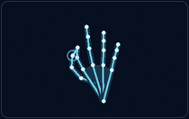
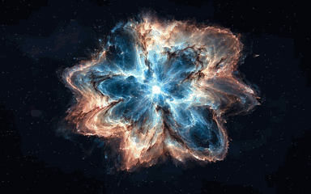
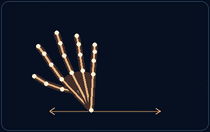
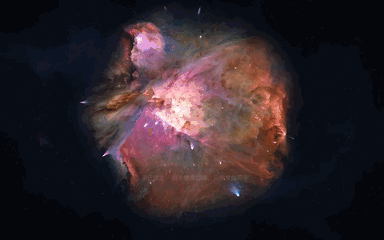
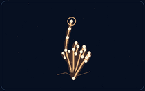
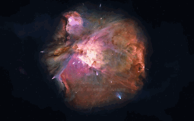

<!-- README_SYNC: source=working-tree; updated=2026-11-10 -->

<p align="center"><a href="./README.md">简体中文</a> · English</p>

<h1 align="center">Xingchen · Celestial Drift</h1>
<p align="center">Open your hand and watch the dust lanes of a star atlas separate into layers of orbiting particles.</p>

<p align="center">
  <strong><a href="https://shengjidaguai-china.github.io/xingchen/">Try it live</a></strong> ·
  <a href="https://github.com/shengjidaguai-china/xingchen">Star the project</a> ·
  <a href="https://github.com/shengjidaguai-china">Follow the community</a>
</p>

<p align="center">
  <a href="https://github.com/shengjidaguai-china/xingchen/stargazers"></a>
  <a href="https://github.com/shengjidaguai-china/xingchen/issues"></a>
  <a href="./LICENSE"></a>
</p>

<h2 align="center">Try it in your browser</h2>

Open the live site in desktop Chrome or Edge. Scroll or drag the slider to see the atlas dissolve into spinning stardust. Choose from the Orion Nebula M42, the Pinwheel Galaxy M101, and the AI-generated Celestial Bloom. The Celestial Bloom unfolds when you arrive. You can skip the prologue and use the scroll wheel or slider to try the transformation.

| Interaction | Gesture guide | In the browser |
| :--- | :---: | :---: |
| **Atlas ↔ Stardust** | Pinch / open your main hand<br> |  |
| **Switch scenes** | Swipe sideways with your other hand<br> |  |
| **Meteor pen** | Point, pause, then trace<br> |  |

The left animations illustrate the gestures. The right animations were recorded in the browser using simulated hand landmarks.

Select the camera button and grant permission to see a mirrored 16:9 preview in the lower-right corner. Cyan landmarks identify the primary hand and gold landmarks identify the secondary hand. Swap roles in the preview or hide it while keeping gestures active. The browser processes camera frames and gestures on your device.

<h2 align="center">How the atlas turns into stardust</h2>

[volume.js](./volume.js) samples colors and positions from the images and gives the particles depth. [app.js](./app.js) uses a shared release field to fade the image and reveal its particles, preserving the colors and the shape of the dust lanes through the transition. The particles settle into layered orbits. Pinching reverses the motion.

[hand-runtime.js](./hand-runtime.js) detects hand landmarks with MediaPipe. The compatibility path runs TensorFlow.js in a local Web Worker via [hand-worker.js](./hand-worker.js), and [canvas-universe.js](./canvas-universe.js) renders the scene when WebGL is unavailable.

<h2 align="center">Run locally</h2>

You need Python 3 and a browser with camera support. Run the following commands, then open `http://localhost:8767/`.

```bash
git clone https://github.com/shengjidaguai-china/xingchen.git
cd xingchen
python3 -m http.server 8767 --bind 127.0.0.1
```

The [usage guide in Chinese](./使用说明.txt) covers the controls in more detail. If the camera fails to start, check browser permissions and whether another application is using it.

<h2 align="center">Credits and participation</h2>

The project code uses the [MIT License](./LICENSE). Astronomical images and third-party components retain their respective licenses.

The Orion and Pinwheel scenes use ESA/Hubble observations. Celestial Bloom uses an AI-generated image. The deformations and orbits are artistic interpretations. See [asset credits](./素材来源.txt) for full attribution and third-party licensing.

[Star Xingchen](https://github.com/shengjidaguai-china/xingchen) to save it for later. If you would like to help, try a browser or camera, then [open an issue](https://github.com/shengjidaguai-china/xingchen/issues) with the gesture, what you observed, and steps to reproduce it.
